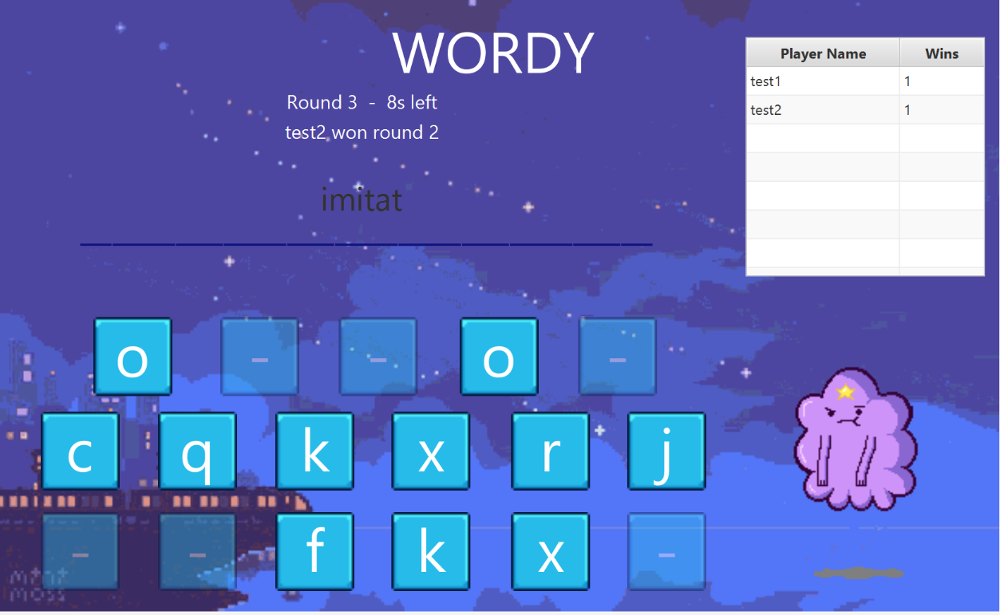
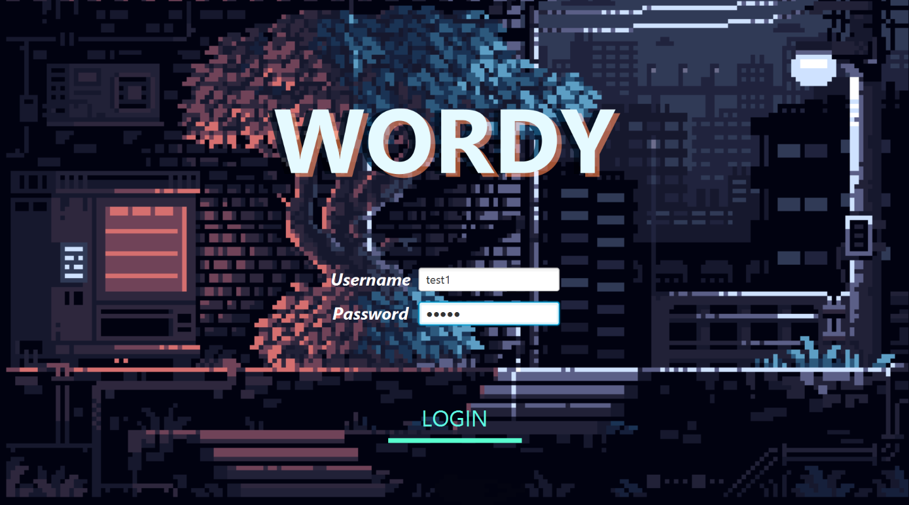
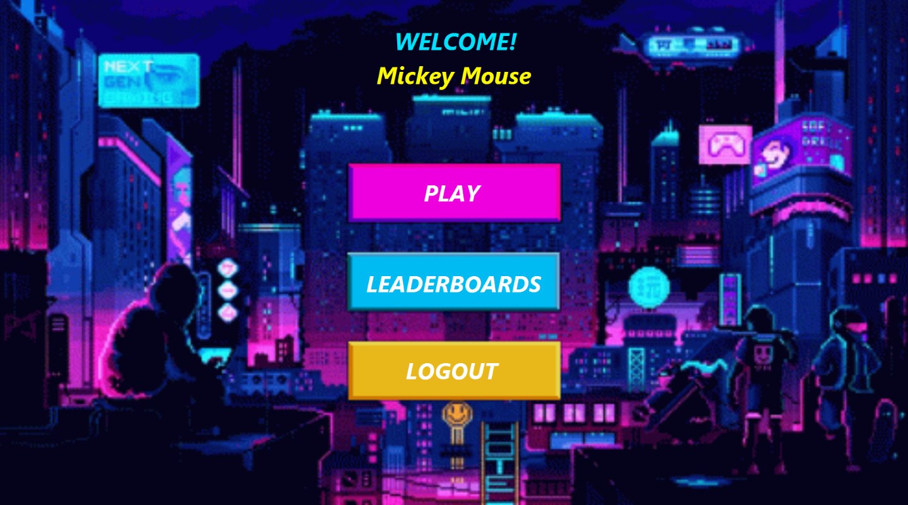
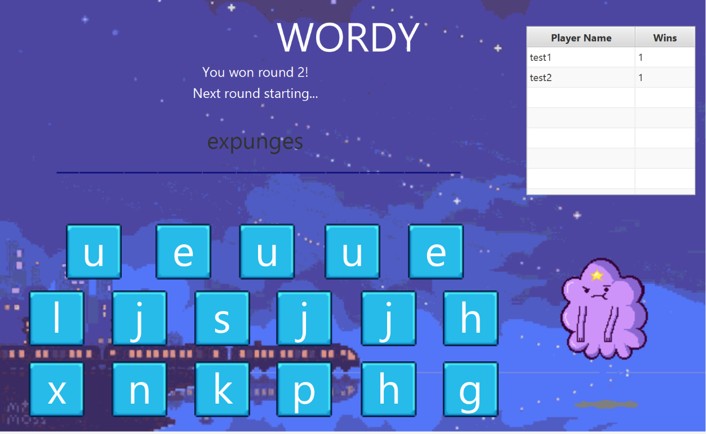
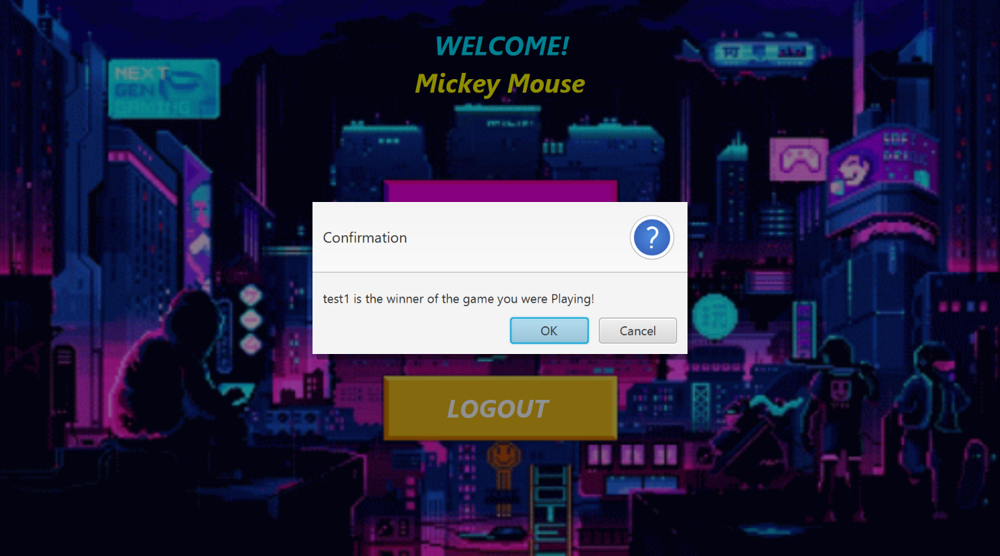
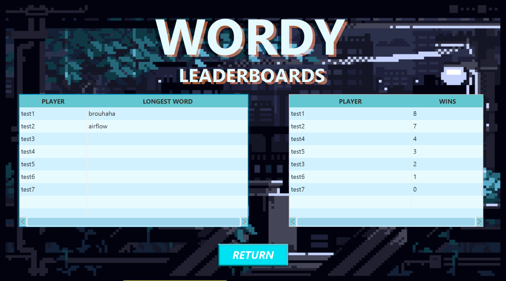

# Wordy — Multiplayer Word Game (Java CORBA + JavaFX)

A real-time multiplayer word game built as a distributed client–server system: JavaFX desktop clients talk to a central game server over **CORBA (IIOP)**, and the server keeps players, wins and the dictionary in **MySQL**.



- Players log in, join a lobby, and every round each player gets the same set of **17 random letters** (5 vowels + 12 consonants).
- Within a **15-second** round, each player submits the longest valid word they can build (minimum **5 letters**, checked against a 57k-word dictionary).
- The longest word wins the round; the first player to **3 round wins** wins the game.
- Leaderboards show top players by wins and by longest word.

**Tech:** Java 8 · CORBA / IDL (`idlj`, `orbd`) · JavaFX + FXML + CSS · MySQL / JDBC

## Screenshots

| Login | Main menu |
|---|---|
|  |  |
| **Lobby — waiting for players** | **In a round** |
|  |  |
| **Round result** | **Game winner** |
|  |  |
| **Leaderboards** | |
|  | |

## Team

Final group project for 9322 (2nd semester, AY 2022–2023), Saint Louis University:

Remo Del Rosario · Jarvis Zarate · Felitra Avillanoza · Eurecho Aque · Kiefer John M. Sanchez · Iko · kaizeroman

## Architecture

```
 JavaFX client (client.ClientMain)  ──┐
 JavaFX client (client.ClientMain)  ──┼── CORBA / IIOP ──► WordyServer (server.*) ──JDBC──► MySQL (wordybase)
 Console client (client.ConsoleVersion)┘        ▲
                                                │ looks up name "Word"
                                       orbd (CORBA Naming Service)
```

| Layer   | Location | Notes |
|---------|----------|-------|
| IDL contract | `src/common/WordyIDL.idl` | module `wordyApp`, interface `Wordy` |
| Generated CORBA stubs | `src/common/wordyApp/` | generated by `idlj`, package `common.wordyApp` |
| Server | `src/server/` | `WordyServer` (main), `WordyImpl` (game logic), `DatabaseProcessor` (JDBC) |
| JavaFX client | `src/client/ClientMain.java`, `src/client/controller/` | controllers for Login, Menu, Game, Leaderboards |
| Console client | `src/client/ConsoleVersion.java` | text-only client, same server |
| UI resources | `resources/fxml/`, `resources/assets/` | FXML views, GIFs, fonts, CSS |
| Database dump | `resources/database/wordybase.sql` | `players` and `words` tables |

## Requirements (versions)

| Component | Required version | Why |
|-----------|------------------|-----|
| **JDK** | **Java 8 (1.8) with JavaFX bundled** — Amazon Corretto 8 (used by the original IntelliJ project), Azul **Zulu 8 FX** build, or BellSoft Liberica 8 **Full** | `org.omg.CORBA`, `orbd` and `idlj` were removed in Java 11; JavaFX was removed from the JDK after Java 8. Language level is 8. |
| **MySQL** | 8.0.x (dump made with **MySQL 8.0.31**, phpMyAdmin 5.2.0) | XAMPP / WampServer / standalone MySQL all work |
| **MySQL JDBC driver** | `mysql-connector-j-8.0.31.jar` | included in `libraries/` |
| **IDE (optional)** | IntelliJ IDEA (project files in `.idea/`) | project SDK name: `corretto-1.8` |

> Tested: the full source tree compiles with **Zulu 8u372 (FX)** — `javac 1.8.0_372`.
>
> Quick check that your JDK has JavaFX: the file `<JDK>/jre/lib/ext/jfxrt.jar` must exist.

## Setup

### 1. Install a Java 8 JDK with JavaFX
Install one of the JDKs above and make sure `java -version` reports `1.8.x`, and that `orbd` and `idlj` are on your `PATH` (they live in `<JDK>/bin`).

### 2. Create the database
1. Start MySQL on `localhost:3306`.
2. Create the database (the dump does **not** contain `CREATE DATABASE`), then import `resources/database/wordybase.sql` into it (phpMyAdmin → select `wordybase` → Import, or):
   ```sh
   mysql -u root -p -e "CREATE DATABASE wordybase"
   mysql -u root -p wordybase < resources/database/wordybase.sql
   ```
   This creates the `players` and `words` tables with seed data.

   **XAMPP / MariaDB:** MariaDB (e.g. XAMPP's 10.4) rejects the MySQL-8 collation in the dump (`Unknown collation: 'utf8mb4_0900_ai_ci'`). Import it with the collation swapped (Git Bash):
   ```sh
   sed 's/utf8mb4_0900_ai_ci/utf8mb4_general_ci/g' resources/database/wordybase.sql | /c/xampp/mysql/bin/mysql.exe -u root wordybase
   ```
   Test accounts after import: `test1`/`test1` … `test7`/`test7`.
3. The server connects with the credentials hardcoded in `src/server/DatabaseProcessor.java`:
   ```
   jdbc:mysql://localhost:3306/wordybase   user: root   password: (empty)
   ```
   Change them there if your MySQL setup differs.

### 3. Run from VS Code (recommended)
The repo includes `.vscode/` config. JDK path is set to `C:\Program Files\Zulu\zulu-8` in `tasks.json` (`JDK8`), `launch.json` (`javaExec`) and `settings.json` — change all three if your Java 8 + JavaFX JDK is elsewhere. Do **not** rely on `JAVA_HOME` if it points to a JDK without JavaFX.

1. Start MySQL/MariaDB (XAMPP or WampServer control panel).
2. `Ctrl+Shift+P` → **Tasks: Run Task** → **Start Naming Service (orbd)** — leave its terminal open.
3. **Tasks: Run Task** → **Run Server** (builds into `build/` first). Wait for `WordTester ready and waiting ...`.
4. **Tasks: Run Task** → **Run Client** — run it twice for two players.

`Ctrl+Shift+B` builds only. For breakpoints, install the *Extension Pack for Java* and use the Run and Debug configs (Server / Client / Console client); orbd still has to be started via the task.

### 4. Open in IntelliJ (optional)
- Open the project folder; set the Project SDK to your Java 8 JDK (the project expects one named `corretto-1.8`).
- `src/` is the source root and `resources/` is a resource root — keep it that way: FXML/CSS are loaded with `getResource("../fxml/...")` relative to the `client` package, so `resources/` contents must end up at the classpath root.
- The project library `libraries` lists `libraries/jfxrt.jar` and `libraries/javafx-src.zip`, **which are not in the repo**. If your JDK already bundles JavaFX you can ignore/remove those entries; otherwise copy `jfxrt.jar` there.

## Running

Order matters: **MySQL → Naming Service → Server → Clients**. Port `1050` below is a convention; any free port works as long as all three use the same one.

### 1. Start the CORBA Naming Service
Run from the project root (it creates/uses the `orb.db/` folder there):
```sh
orbd -ORBInitialPort 1050 -ORBInitialHost localhost
```
Leave it running.

### 2. Start the server
Main class `server.WordyServer`, program arguments:
```
-ORBInitialPort 1050 -ORBInitialHost localhost
```
It prints `WordTester ready and waiting ...` when bound as `Word` in the naming service.

### 3. Start the clients (at least 2 to play)
Main class `client.ClientMain` (JavaFX) — or `client.ConsoleVersion` (console) — with the same program arguments:
```
-ORBInitialPort 1050 -ORBInitialHost localhost
```
To play across machines, replace `localhost` with the IP of the machine running `orbd`.

### Command line (no IDE)
From the project root (Git Bash shown; on cmd/PowerShell use `;` in the classpath — it is already `;` below because this is Windows):
```sh
# compile
mkdir -p build
javac -encoding UTF-8 -d build -cp libraries/mysql-connector-j-8.0.31.jar $(find src -name "*.java")
cp -r resources/* build/          # FXML/assets must sit at the classpath root

# run (each in its own terminal)
orbd -ORBInitialPort 1050 -ORBInitialHost localhost
java -cp "build;libraries/mysql-connector-j-8.0.31.jar" server.WordyServer -ORBInitialPort 1050 -ORBInitialHost localhost
java -cp "build" client.ClientMain -ORBInitialPort 1050 -ORBInitialHost localhost
```
(On macOS/Linux use `:` instead of `;` in `-cp`.)

### Test accounts
See the `INSERT INTO players` rows in `resources/database/wordybase.sql`.

## Troubleshooting

| Symptom | Cause / fix |
|---------|-------------|
| `package javafx... does not exist` / `ClassNotFoundException: javafx...` | JDK has no JavaFX. Use Corretto 8, Zulu 8 FX, or Liberica 8 Full. |
| `package org.omg.CORBA does not exist` | You are on Java 11+. Switch to Java 8 (or see *Migrating* below). |
| `org.omg.CORBA.COMM_FAILURE` / `TRANSIENT` / `connection refused` | `orbd` not running, or port/host args differ between orbd, server and client. |
| `NotFound` when resolving `Word` | Server not started (or crashed) before the client. Restart the server. |
| `Communications link failure` on server | MySQL not running, or wrong credentials in `DatabaseProcessor`. |
| Login says **"Account Already Logged In"** | `isActive` is stored in the DB and stays `1` if a client/server crashed. Reset: `UPDATE players SET isActive = 0;` |
| `Location is not set` when loading FXML | `resources/` contents are not at the classpath root (see command-line `cp` step / IntelliJ resource root). |
| "No other players" after the 15 s lobby | Only one client pressed Play. At least 2 players must join within the lobby countdown. |

## Migrating to Java 11+ (not done — notes only)

The code runs as-is only on Java 8. To move to Java 11/17/21:

1. **CORBA** — add a standalone ORB, e.g. GlassFish CORBA (Maven `org.glassfish.corba:glassfish-corba-orb` + `glassfish-corba-omgapi`, plus their deps such as `pfl-basic`, `pfl-tf`, `gmbal-api-only`, `management-api`). Package names `org.omg.*` stay the same, so code changes are minimal. Replace `orbd` with the naming service shipped by that ORB (GlassFish: `com.sun.corba.ee.impl.naming.cosnaming.TransientNameServer`), or start a naming service inside the server process. Use that ORB's `idlj` if the IDL changes.
2. **JavaFX** — download the OpenJFX SDK matching your JDK and run with
   `--module-path <openjfx>/lib --add-modules javafx.controls,javafx.fxml`.
3. Introduce a build tool (Maven/Gradle) to manage these jars instead of committing them to `libraries/`.
4. Re-test resource loading: the `getResource("../fxml/...")` relative paths may behave differently once packaged in a jar — switch to absolute paths like `"/fxml/LoginMain.fxml"`.

## Assets
GIF/PNG assets used by the UI are in `resources/assets/` (login, loading, waiting, game and leaderboard screens). README screenshots are in `docs/screenshots/`.
